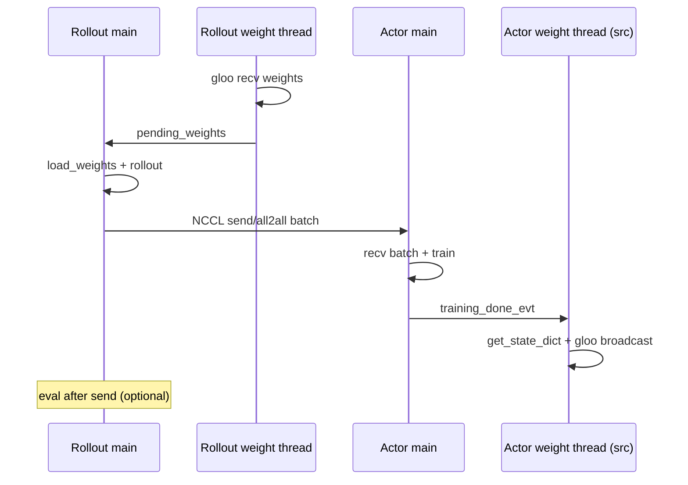

# 异步流水线设计

本文描述 **`algorithm.pipeline_mode: async`** 的调度语义、线程模型、与通信层的关系。Async 适用于 **混合 placement**（spatial split，如 rollout 0–5 + actor 6–7）和 **分离 placement**（disaggregated）。

**Sync（共置全卡时序复用）** 见 [sequential_sync_design.md](sequential_sync_design.md)；混合/分离 **仅 async**，不提供 sync。

实现：`joyrlinf/runners/embodied_runner.py` 中 `_run_*_loop_async`。

---

## 1. 动机

Embodied RL 每步包含 **Rollout（仿真+推理）** 与 **Actor（优势+GRPO 训练）** 两条长临界区。若 rollout 与 actor **分占不同 GPU 且逐步 barrier**（旧 spatial sync，已废弃），总时间 ≈ \(T_{\text{rollout}} + T_{\text{actor}}\)。Async 通过 **权重后台广播** 与 **batch 先 recv 后 train**，使稳态步长逼近：

\[
T_{\text{step}} \approx \max(T_{\text{rollout path}},\; T_{\text{actor path}})
\]

其中 rollout path 含 weight load、rollout、send、（可选）eval。

---

## 2. Async vs Sync 对照

| 维度 | Async（混合/分离） | Sync（共置全卡，见 sequential 文档） |
|------|-------------------|----------------------------------------|
| 适用拓扑 | rollout ≠ actor 或 env ≠ rollout | env == rollout == actor |
| 并行方式 | 空间并行 + 重叠 | 时间 phase A→B |
| 全局 barrier | 无跨组件步级 barrier | 每 phase 边界 barrier |
| 权重 | 后台 Gloo broadcast | CPU staging，无广播 |
| Batch | NCCL v1/v2 | 无（rank-local） |
| 权重新鲜度 | ≤1 step stale | strict on-policy |
| 进度条 | Actor rank 0 tqdm | Sync：rank 0 tqdm |

---

## 3. Async 线程模型



### 3.1 Rollout

- **主线程**：`load_weights` → `rollout_epoch` → `_send_batch_v2` → `_run_rollout_eval_if_needed`
- **`weight_recv_loop`**：循环 `_recv_weights_raw()`，写入 `pending_weights`（持 `weight_lock`）

首步前有一次 **同步** `_sync_weights_from_actor()` 保证初始权重。

### 3.2 Actor

- **主线程**：`_recv_batch_v2` → `receive_rollout_batch` → 等 `weights_extracted_evt` → `compute_advantages` → **actor_group barrier** → `run_training` →（可选）save → `training_done_evt.set()`
- **`weight_broadcast_loop`（仅 `wb_src_actor`）**：等 `training_done_evt` → `get_state_dict` → `_broadcast_weights_from_sd`

**顺序要点**：Actor **先 recv batch** 再 wait 权重提取，避免 rollout NCCL send 阻塞过久引发级联超时。

### 3.3 与通信文档的交叉约束

- Batch：**NCCL**（v1/v2）
- 权重：**Gloo CPU**（独立 `weight_broadcast` 组）
- 两组 Process Group 不同 → 主线程 batch 与后台权重可并发

---

## 4. 单步时序（Async，co-located + v2）

```text
时间 →
Rollout:  [load_w][====rollout====][==send==][eval?]
Actor:              [==recv==][adv][barrier][====train====]
Weight:                                                      [bcast]
```

- Send 在 eval **之前**：Actor 可先训练，eval 与 actor train **部分重叠**（当 actor 为瓶颈时有效）。
- Eval 仍占用 rollout GPU，不能与 rollout 下一段重叠。

---

## 5. 权重陈旧度（Staleness）

日志字段 `staleness = step - last_weight_apply_step`：

- `0`：本步已应用最新 `pending_weights`
- `1`：本步 rollout 用的仍是上一步权重（常见、可接受）
- `>1`：rollout 慢于权重到达频率，需查 bottleneck 或减 `rollout_epoch`

Async **不保证** on-policy 严格对齐；用 1-step stale policy 换吞吐。

**Eval**：使用 `pending_weights` 快照，可能与当前 train step 差 0–1 步，仅影响监控指标。

---

## 6. Checkpoint 与 Async

- 保存发生在 **actor 主线程**、`run_training` 之后、`training_done_evt.set()` **之前**（src actor）。
- **无** save 后 actor 全局 barrier，避免 rank 7 迟进 all2all recv。
- 权重线程在 `training_done_evt` 后才读 `state_dict`，与 save 不竞态。

---

## 7. 何时选 Async / Sync

| 选 Async | 选 Sync |
|----------|---------|
| 混合 placement（rollout 与 actor 分 GPU） | 共置且 **env=rollout=actor 全卡复用** |
| Disaggregated（env ≠ rollout） | strict on-policy、staleness=0 实验 |
| 生产长训、吞吐优先 | 全卡采样 + 全卡训练对比 |

混合/分离配置若写 `pipeline_mode: sync`，校验失败。

---

## 8. 已知限制

1. **Disaggregated + async**：env 循环无全局 barrier，依赖 rollout P2P 驱动；需保证 env/rollout 配对正确。
2. **Eval TB 指标**：可能晚 1 step 写入（见 observability 文档）。
3. **tqdm**：仅 actor 侧；rollout 看 `[ASYNC] Rollout step` 日志。
4. **Disaggregated 多机**：env 与 rollout 跨机 NCCL 时延未在 async 中特殊优化。

---

## 9. 配置

```yaml
algorithm:
  pipeline_mode: async   # 混合/分离；共置 sync 见 sequential_sync_design.md
  comm_mode: v2
  rollout_epoch: 1

cluster:
  component_placement:
    actor: 6-7
    env: 0-5
    rollout: 0-5
```

---

## 10. 代码索引

| 逻辑 | 函数 |
|------|------|
| Rollout async | `_run_rollout_loop_async` |
| Actor async | `_run_actor_loop_async` |
| Sync（共置） | `_run_colocated_sync_loop`（见 sequential 文档） |
| 入口分发 | `EmbodiedRunner.run()` 按 `pipeline_mode` |
