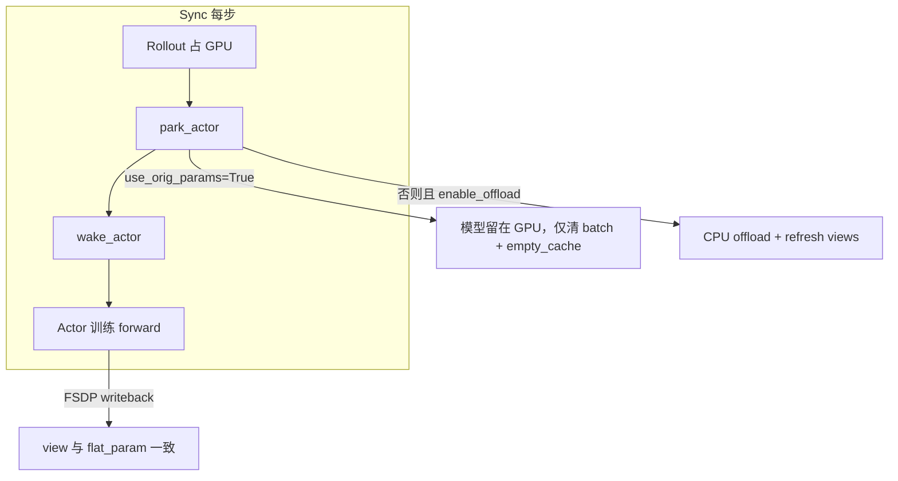

# OpenVLA-OFT 共置 Sync 训练：FSDP `use_orig_params` 修复说明

> **适用场景**：`pipeline_mode: sync`，OpenVLA-OFT + LoRA，`fsdp_config.use_orig_params: true`  
> **典型配置**：`configs/maniskill_grpo_openvla_oft_sync.yaml`  
> **参考仓库**：`/ufs_500T/gyc/joyrlinf`（commit `2974734` 及后续对齐）

---

## 1. 问题现象

在 Sync 第 2/3 步（rollout 结束 → `park_actor` → 下一步 `wake_actor` → actor 训练 forward）时，进程崩溃：

```text
RuntimeError: Cannot writeback when the parameter shape changes
  expected [1024] but got [1, 1, 1024]
```

或伴随 FSDP / gradient checkpointing 相关的 orig-param view 不一致。

**触发条件（同时满足时必现）**：

| 条件 | 说明 |
|------|------|
| `use_orig_params: true` | OpenVLA LoRA 需要，与 `no_shard` 搭配 |
| Sync phase 切换 | `park_actor()` / `wake_actor()` 在 rollout 与 actor 之间切换 |
| CPU offload park | 将 FSDP `flat_param` 手动搬到 CPU 再搬回 GPU |

当前 ManiSkill OpenVLA sync 配置中 `enable_offload: False`，但 **旧实现仍会在 park 时做 CPU offload**（或错误地依赖 `enable_offload` 而非 `use_orig_params`），从而触发 writeback。

---

## 2. 根因

FSDP 在 `use_orig_params=True` 时，为每个 logical parameter 维护与 `FlatParameter` 绑定的 **view 映射**。Sync 模式下 `ActorWorker.park_actor()` 通过 `offload_params_and_grads()` 把 `flat_param` 移到 CPU：

1. 仅改 `param.data` 或粗暴移动 flat_param，**不会**自动调用 FSDP 内部的 view 同步；
2. 下一步 training forward 时 FSDP 尝试 writeback，logical param 的 shape/view 已与 flat_param 不一致 → 报错。

此外有两类 **独立但相关** 的问题：

| 问题 | 后果 |
|------|------|
| **Auto-wrap 找错根模块** | 在 `OpenVLAOFTForRLActionPrediction` 顶层找 `language_model`，OpenVLA 找不到 → 可能无法按 decoder layer 正确 wrap |
| **Reentrant gradient checkpointing** | 在 `use_orig_params` + FSDP 下可能加剧 writeback/view 问题 |

---

## 3. 修复总览

修复分 **两个 commit**，职责分离：

| Commit | 文件 | 内容 |
|--------|------|------|
| `546ad0e` | `fsdp_trainer.py`, `actor_worker.py`, `openvla_oft_model.py` | writeback 主修复：view refresh、park 行为、非 reentrant CKPT |
| `e8e7dd7` | `fsdp_trainer.py`, `actor_worker.py` | 与参考仓库对齐：`wrap_root`、`_skip_cpu_park` |



---

## 4. 四项修复详解

### 4.1 FSDP Auto-Wrap：`wrap_root = model.model`（`e8e7dd7`）

**问题**：传给 `setup_fsdp()` 的是 `OpenVLAOFTForRLActionPrediction`，其 HF 主体在 `.model`，`language_model` 在 `.model.language_model` 下。旧代码在顶层 `hasattr(model, "language_model")` 为 False，`_no_split_modules` 与 `get_module_class_from_name` 可能全部失效。

**修复**（`joyrlinf/training/fsdp_trainer.py` → `_get_auto_wrap_policy`）：

```python
wrap_root = model
if hasattr(model, "model") and hasattr(model.model, "language_model"):
    wrap_root = model.model

#  thereafter: wrap_root.language_model._no_split_modules
#               get_module_class_from_name(wrap_root, layer_name)
```

**效果**：与 RLinf / 参考 joyrlinf 一致，按 Llama decoder layer 做 FSDP auto-wrap，而不是退化成「几乎不 wrap」的单层 FSDP。

---

### 4.2 Park / Unpark：`_skip_cpu_park = use_orig_params`（`e8e7dd7`）

**问题**：`546ad0e` 之前用 `enable_offload` 决定是否 CPU park。若有人设置 `enable_offload: true` 且 `use_orig_params: true`，仍会 offload 并崩溃。

**修复**（`joyrlinf/workers/actor_worker.py`）：

```python
# build_actor 末尾
self._skip_cpu_park = bool(
    self.cfg.actor.get("fsdp_config", {}).get("use_orig_params", False)
)

# park_actor：_skip_cpu_park 时
#   - 清空 batch
#   - cuda.synchronize + empty_cache
#   - 标记 _parked=True，权重留在 GPU
# wake_actor：_skip_cpu_park 时 no-op，仅 _parked=False
```

**与参考仓库对齐**：参考 `/ufs_500T/gyc/joyrlinf` 使用相同语义（`_skip_cpu_park` 绑定 `use_orig_params`，而非 `enable_offload`）。

**当前 sync 配置**（`enable_offload: False` + `use_orig_params: true`）下，行为与 `546ad0e` 的「不 offload」等价，但语义更正确、可防配置误用。

---

### 4.3 Offload 安全：view refresh + 禁止路径（`546ad0e`）

**原则**：`use_orig_params=True` 时，**主路径永不调用** `offload_params_and_grads`（由 `_skip_cpu_park` 保证）。

**若将来必须在其他场景手动搬运 flat_param**（`joyrlinf/training/fsdp_trainer.py`）：

1. 遍历所有 FSDP handle 的 `flat_param`（`_iter_fsdp_handles`），避免重复搬运共享 flat_param；
2. 每次 device 变更后调用 `_refresh_handle_views` → `handle._use_sharded_views()`；
3. `load_state_dict` 后调用 `_refresh_orig_param_views(self.fsdp_model)`（`actor_worker` 权重 staging）。

**不要**：直接对 `named_parameters()` 里的 `param.data` 做 `.to("cpu")` 而不 refresh — 这是 writeback 崩溃的直接原因之一。

文档注释（`offload_params_and_grads` docstring）已标明：调用方在 `use_orig_params=True` 时应跳过，见 `ActorWorker._skip_cpu_park`。

---

### 4.4 Gradient Checkpointing：`use_reentrant=False`（`546ad0e`）

**位置**：`joyrlinf/models/openvla_oft_model.py`，训练模式 build 时：

```python
inner.language_model.gradient_checkpointing_enable(
    gradient_checkpointing_kwargs={"use_reentrant": False},
)
```

**说明**：参考仓库仅 `gradient_checkpointing_enable()`；本仓库额外指定 `use_reentrant=False`，作为 FSDP + `use_orig_params` 下的 **防护**，与参考不冲突，建议保留。

---

## 5. 与参考仓库对照表

| 项 | 参考 `/ufs_500T/gyc/joyrlinf` | 本仓库（`546ad0e` + `e8e7dd7`） |
|----|------------------------------|----------------------------------|
| FSDP wrap | `wrap_root = model.model` | 已对齐（`e8e7dd7`） |
| Park/Unpark | `_skip_cpu_park = use_orig_params` | 已对齐（`e8e7dd7`） |
| Offload | 文档警告 + 永不走 offload | 同上 + `_refresh_orig_param_views` 兜底 |
| Gradient CKPT | 默认 enable | enable + `use_reentrant=False` |

---

## 6. 推荐配置

`configs/maniskill_grpo_openvla_oft_sync.yaml` 中与本次修复相关的片段：

```yaml
actor:
  enable_offload: False          # sync 共置：不要 CPU park offload
  fsdp_config:
    sharding_strategy: no_shard  # LoRA 混合 requires_grad
    use_orig_params: true        # 必须；触发 _skip_cpu_park
    gradient_checkpointing: true
```

**禁止组合**（除非另行验证 FSDP 版本与 refresh 逻辑）：

- `use_orig_params: true` + sync `park_actor` CPU offload
- `use_orig_params: true` + `enable_offload: true`（`_skip_cpu_park` 会阻止 build 时 offload，但不应依赖误配）

**若需省显存**：优先调 `micro_batch_size`、env 数量、或 async 拓扑；不要指望在 `use_orig_params=True` 下用 CPU park 换显存。

---

## 7. 验证

1. **启动**：`torchrun --nproc_per_node=8 scripts/train.py --config configs/maniskill_grpo_openvla_oft_sync.yaml`
2. **通过 Sync step 2/3**：日志应出现  
   `ActorWorker parked (model stays on GPU, use_orig_params=True, rank=N)`  
   而非 `parked on CPU`。
3. **训练 forward**：无 `Cannot writeback when the parameter shape changes`。
4. **FSDP wrap**（可选）：启动日志中 auto-wrap 应能找到 decoder layer 类名，而非大量 `Auto-wrap class not found`。

---

## 8. 涉及文件速查

| 文件 | 职责 |
|------|------|
| `joyrlinf/training/fsdp_trainer.py` | `_get_auto_wrap_policy`, `_refresh_orig_param_views`, `offload/onload_params_and_grads` |
| `joyrlinf/workers/actor_worker.py` | `_skip_cpu_park`, `park_actor`, `wake_actor`, `load_state_dict` 后 refresh |
| `joyrlinf/models/openvla_oft_model.py` | `gradient_checkpointing_enable(use_reentrant=False)` |
| `configs/maniskill_grpo_openvla_oft_sync.yaml` | `enable_offload: False`, `use_orig_params: true` |

---

## 9. loss_mask 与 truncation bootstrap（action_level）

与 RLinf `env_worker.bootstrap_step` 对齐的 dones 布局：

| 布局 | `dones` 形状 | 说明 |
|------|-------------|------|
| **修复后** | `[T+1, B, C]` | 第 0 行全 False（首个 action 前）；第 `t+1` 行为 chunk `t` 结束后的 done（truncation 在 `C-1` 子步） |
| **修复前（错误）** | `[T, B, C]` + 末尾零 bootstrap | 缺少 leading zero，mask 与 RLinf 不一致 |

`compute_loss_mask(dones)`（`embodied_advantages.py`）对 flattened dones 做 `cumsum==0` 截断，episode 在 truncation 之后不再参与 policy loss / advantage。

验证脚本：`scripts/debug_dones_mask.py`（对比 old vs RLinf layout）。

---

## 10. 相关文档

- [sequential_sync_design.md](sequential_sync_design.md) — Sync phase 与 park/wake 语义
- [memory_design.md](memory_design.md) — 显存与 offload 策略
- 参考仓库 GRPO 调试总览：`/ufs_500T/gyc/joyrlinf/docs/debugging_grpo_policy_loss.md`（含 reward/loss 等其他问题，与本次 FSDP 修复正交）
