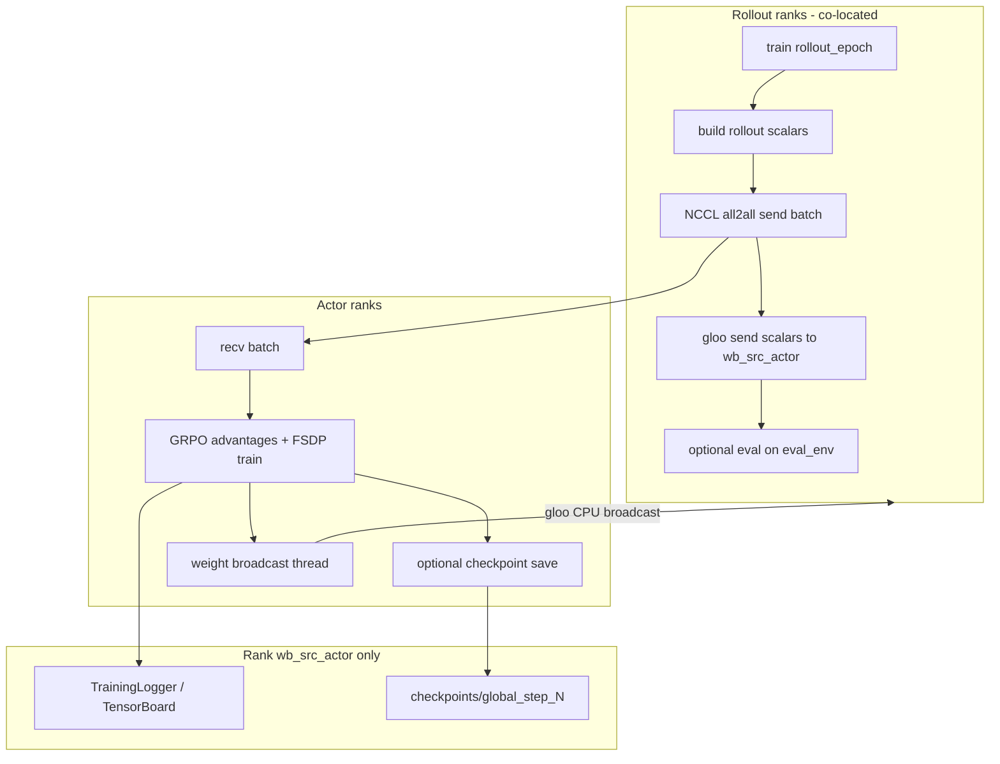

# joyrlinf：TensorBoard / Eval / Checkpoint / 断点续训 设计说明

本文档描述 [joyrlinf](../joyrlinf) 在 embodied async 训练（以 `maniskill_grpo_pi05_async_test1.yaml` 为代表）中，实验观测、周期性评估、模型保存与断点续训的设计与使用约定。实现参考 [RLinf-main](https://github.com/RLinf) 的 runner 调度模式，在 **SPMD 多进程**（Rollout / Actor 分 rank）前提下做轻量化适配。

相关文档：[通信](communication_design.md) · [显存](memory_design.md) · [异步](async_pipeline_design.md) · [多机](multinode_design.md) · [文档索引](README.md)

---

## 1. 设计目标

| 目标 | 说明 |
|------|------|
| 可观测 | 训练过程有 TensorBoard 曲线，无需改代码即可 `tensorboard --logdir ...` |
| 可评估 | 训练中使用 held-out `env.eval`（如 `obj_set: test`）周期性算 success / return |
| 可恢复 | 按 step 保存 Actor 训练状态，支持从 `global_step_N` 继续训 |
| 低侵入 | 复用已有 `TrainingLogger`、`rollout_eval()`；不引入 Hydra / DCP |
| Async 友好 | 不与 async 权重广播、NCCL all2all 抢同一条通信链路 |

**非目标（当前版本）**：WandB 默认开启、独立 eval-only 入口、disaggregated 专用 eval GPU、eval 后自动释放 eval env。

---

## 2. 总体架构



**单点写盘**：仅 `wb_src_actor`（`component_placement` 中 actor 组的 weight broadcast 源 rank，如 rank 6）创建 `TrainingLogger` 并写 TensorBoard / 触发 checkpoint 落盘。

**训练步编号**：全局 **`step` 为 1-indexed**（第 1 次迭代 `step=1`）。循环为：

```python
for step in range(global_step + 1, max_steps + 1):
    ...
```

`check_progress(step, ...)` 在 `step % val_check_interval == 0` 时触发 eval（例如 interval=2 → step 2, 4, 6…）。

---

## 3. TensorBoard

### 3.1 组件

| 模块 | 路径 | 职责 |
|------|------|------|
| `TrainingLogger` | `joyrlinf/utils/logging.py` | 封装 `SummaryWriter` / WandB；`histogram_interval` 控制直方图采样 |
| `MetricsEmitter` | `joyrlinf/observability/emitter.py` | 结构化 `StepMetrics` → TB / `perf_summary.json` |
| `_emit_step_metrics` | `joyrlinf/runners/embodied_runner.py` | 每步聚合 train/adv/rollout/eval/time/memory/data |
| 配置快照 | `{log_path}/{experiment_name}/config.yaml` | 启动时由 `wb_src_actor` 写入 |

### 3.2 目录与启动

默认产物根目录（**从头训**自动按启动时间分子目录）：

```text
{runner.logger.log_path}/{runner.logger.experiment_name}/runs/YYYYMMDD_HHMMSS/
  tb/
  config.yaml
  checkpoints/global_step_{N}/actor/...
```

### 3.2.1 目录与覆盖

| 场景 | 写入位置 |
|------|----------|
| 从头训 | 新建 `runs/<JOYRLINF_RUN_ID>/`（多机 rank 对齐同一时间戳） |
| 续训（`resume_dir`） | 解析为 checkpoint 所在 run 目录，不新建时间戳 |
| 控制台日志 | `logs/<时间戳>_<config>_nodeN.log`，与 results 分开 |

同一 `experiment_name` 下可并存多次 run；改 `experiment_name` 可区分实验线。

**正确启动方式**（`--logdir` 必须是目录，不能指向单个 events 文件）：

```bash
tensorboard --logdir ./results/maniskill_grpo_pi05_async/tb
# 对外暴露
tensorboard --logdir ./results/maniskill_grpo_pi05_async/tb --bind_all --port 6006
```

### 3.3 指标命名空间

| 前缀 | 来源 | 示例 |
|------|------|------|
| `train/` | Actor `run_training()` | `policy_loss`, `ratio_max`, `entropy`, `proximal_approx_kl` |
| `adv/` | Actor `compute_advantages()` | `adv_mean`, `adv_std`, `values_mean` |
| `data/` | GRPO 诊断 / reward filter | `groups_with_var_pct`, `reward_nonzero_pct` |
| `rollout/` | Rollout 标量通道 | `success_rate` |
| `eval/` | Eval rollout（见 §4） | `success_rate`, `mean_return` |
| `time/` | Rollout + Actor 计时 | `rollout_send`, `rollout_core`, `actor_train`, `throughput_env_s` |
| `memory/` | `GPUMemoryGuard`（sync 共置） | `free_mib`, `critical_events` |

**P1 标量通道**：Rollout 侧标量不再打包为 batch 内 `_runner_metric_*` 张量；`first_rollout` 在 NCCL send 之后经 **gloo CPU `dist.send`** 发往 `wb_src_actor`（`joyrlinf/observability/scalar_transport.py`）。Sync 共置模式用内存 staging，不经网络。旧 batch 捎带仍可通过 `strip_runner_metrics()` 兼容剥离。

### 3.4 配置

```yaml
runner:
  logger:
    log_path: ./results
    project_name: joyrlinf
    experiment_name: maniskill_grpo_pi05_async
    logger_backends: [tensorboard]   # 可选 wandb
    histogram_interval: 10           # 每 N 步写 advantage/ratio 直方图；0=关闭
```

WandB 开启时：`wandb.init(config=...)` 写入完整 yaml；`define_metric` 将 `eval/*` 等与 `global_step` 对齐。

---

## 4. Eval（训练中评估）

### 4.1 语义

- **与训练数据隔离**：`rollout_eval()` 只在 `env.eval` 上跑，返回标量 dict，**不**生成 trajectory batch，**不**进入 `receive_rollout_batch`。
- **与 RLinf 对齐**：独立 `env.eval` 段（`obj_set: test`、较小 `total_num_envs` 等）。

### 4.2 触发逻辑

`joyrlinf/utils/runner_utils.py` → `check_progress()`：

- `val_check_interval > 0` 且 `step % val_check_interval == 0` → 本步做 eval  
- 最后一步 `step >= max_steps` 也可触发 eval  
- 若同时开启 save：`save_interval % val_check_interval == 0`（配置校验）

### 4.3 Rollout 执行路径

| 模式 | 顺序 | 权重 |
|------|------|------|
| **sync** | train rollout → enrich → **send** → barrier → eval（可选） | `_sync_weights_from_actor()` 拉最新权重 |
| **async** | train rollout → **send batch** → **gloo send scalars** → **eval**（可选） | 仅读 `pending_weights`，**禁止**主线程 `_sync_weights_from_actor()`（与 `weight_recv_loop` 冲突） |

**Async 先 send 后 eval 的原因**：让 Actor 尽早 `recv`/`train`，eval 时间与 Actor 训练重叠，降低 Actor 瓶颈时的空等；eval 时间**不能**靠 send 顺序消灭，仍占用 rollout GPU 显存（见 §4.5）。

### 4.4 指标聚合与 TensorBoard 对齐

1. 各 rollout rank 本地 `rollout_eval()` → `eval/success_rate`, `eval/mean_return`  
2. `dist.all_reduce`（rollout group）求平均  
3. Eval 标量随 **同一步** 的 rollout 标量通道发往 `wb_src_actor`，与 `eval step N` 日志 **同 step** 写入 TB（P0/P1 已消除 async 延迟一步）

### 4.5 显存（共用 rollout GPU）

| 组件 | 生命周期 |
|------|----------|
| `env`（train） | 进程启动时创建，常驻 |
| `env.eval` | **lazy** 首次 eval 创建，之后常驻 |
| OpenPI 推理模型 | 与 train rollout 共用一份 |

峰值 ≈ PhysX(train) + PhysX(eval) + 模型 + PyTorch reserved。缓解手段（仅配置）：减小 `env.eval.total_num_envs`、加大 `val_check_interval`、缩小 eval 的 `gpu_memory_config`、训练阶段 `val_check_interval: -1`。

### 4.6 配置示例

```yaml
runner:
  val_check_interval: 20    # <=0 关闭
  save_interval: 40         # 须能被 val_check_interval 整除（若两者都 >0）

env:
  eval:
    total_num_envs: 384       # 须能被 rollout GPU 数整除
    auto_reset: False
    use_fixed_reset_state_ids: True
    max_episode_steps: 80
    init_params:
      obj_set: test
      # 其余 sim 参数建议与 train 对齐
```

离线校验：`python scripts/validate_embodied_config.py --config <yaml>`。

---

## 5. Checkpoint（保存）

### 5.1 目录布局（对齐 RLinf 命名）

```text
{log_path}/{experiment_name}/checkpoints/global_step_{step}/actor/
  model.pt         # FSDP 可训练参数（CPU）
  optimizer.pt
  scheduler.pt
  meta.json        # {"global_step": step}
```

仅 **`wb_src_actor`** 调用 `_save_checkpoint(step)` → `ActorWorker.save_checkpoint()`。

### 5.2 实现要点

| 项 | 说明 |
|----|------|
| 格式 | `FSDP` + `FULL_STATE_DICT` + `rank0_only` + CPU offload（适配 `sharding_strategy: no_shard`） |
| 模块 | `joyrlinf/training/checkpoint.py` |
| 保存后 barrier | **无** actor_group 全局 barrier，避免 rank 7 等盘时阻塞 NCCL all2all recv |
| 与权重线程顺序 | **先** `save_checkpoint`，**再** `training_done_evt.set()`，避免与 `weight_broadcast_loop` 抢 `state_dict` |

### 5.3 触发

`check_progress` → `save_model` 为真时保存：

- `step % save_interval == 0`  
- 或 `step >= max_steps`（最后一步）

### 5.4 配置

```yaml
runner:
  save_interval: 40    # <=0 关闭周期性保存
```

---

## 6. 断点续训（Resume）

### 6.1 配置

```yaml
runner:
  resume_dir: null
  # 示例：
  # resume_dir: ./results/maniskill_grpo_pi05_async/checkpoints/global_step_40
```

指向 **`global_step_{N}` 目录**（其下需存在 `actor/` 子目录），不是 `actor` 路径本身。

### 6.2 流程

1. **所有 role**（Rollout / Env / Actor）从 `resume_dir` 解析 `global_step`（目录名 `global_step_{N}`），保证循环步数、`weight_*_loop` 迭代次数、eval/save 调度一致  
2. 仅 **Actor** 额外 `load_checkpoint({resume_dir}/actor)`；`global_step` 优先 `meta.json`，与路径不一致时打 warning  
3. `OpenPiModel.set_global_step(global_step)`（flow noise 退火等）  
4. 训练循环：`range(global_step + 1, max_steps + 1)`（续训从 step 13 起则 `global_step=12`）  
5. Rollout 首步仍同步 `_sync_weights_from_actor()`，之后 async 走 `weight_recv_loop`

**不保存 / 不恢复**：Rollout 权重缓存、env 状态、replay buffer（本框架无独立 replay）。

### 6.3 使用示例

```bash
# 首次训练
torchrun --nproc_per_node=8 scripts/train.py --config configs/maniskill_grpo_pi05_async_test1.yaml

# 续训：修改 yaml 中 resume_dir 后重新 torchrun（需指向已有 global_step_N）
```

TensorBoard 的 `step` 轴与 checkpoint 中 `global_step` 连续。

---

## 7. Async 下的时序与性能（概念）

设 \(T_r\) = rollout 路径耗时，\(T_a\) = actor 路径耗时。

- **稳态步长** \(\approx \max(T_r, T_a)\)（两条流水线并行）  
- **Rollout 瓶颈**：调 send/eval 顺序对总时长帮助有限；eval 仍加在 rollout 路径上  
- **Actor 瓶颈**：先 send 再 eval 可减少 actor 等 batch；eval 常与 `train` 重叠  

**权重（async）**：

- 唯一消费者：`weight_recv_loop` 后台线程 `_recv_weights_raw()`  
- 主线程只 `load_weights(pending_weights)`  
- Eval **不得**调用 `_sync_weights_from_actor()`（曾导致双接收 gloo 广播死锁）

---

## 8. 配置约束汇总

| 约束 | 原因 |
|------|------|
| `env.eval.total_num_envs % num_rollout_gpus == 0` | 每 rollout rank 均分 eval env |
| `save_interval % val_check_interval == 0`（两者均 >0） | 保存步与 eval 步对齐 |
| `val_check_interval > 0` 时必须配置 `env.eval` | `validate_embodied_training_config` |
| co-located + async eval | 当前仅 `CombinedEnvRolloutWorker` 实现 eval |

---

## 9. 关键代码索引

| 功能 | 文件 |
|------|------|
| 调度 `check_progress` | `joyrlinf/utils/runner_utils.py` |
| TB 写入 | `joyrlinf/utils/logging.py`, `EmbodiedRunner._log_step_metrics` |
| Eval | `joyrlinf/workers/rollout_worker.py::rollout_eval`, `EmbodiedRunner._run_rollout_eval_if_needed` |
| Checkpoint IO | `joyrlinf/training/checkpoint.py`, `joyrlinf/workers/actor_worker.py` |
| 主循环 | `joyrlinf/runners/embodied_runner.py`（`_run_rollout_loop_async`, `_run_actor_loop_async`） |
| 配置校验 | `joyrlinf/core/config_validation.py` |

---

## 10. 常见问题

**Q: TensorBoard 报错 `is not a prefix of run directory`？**  
A: `--logdir` 指到了单个 `events.out.tfevents.*` 文件；应指向 `tb/` 目录。

**Q: Eval 数据会参与训练吗？**  
A: 不会；仅标量进 TB。

**Q: 为何 save 时曾 NCCL 超时？**  
A: 保存后 actor barrier + 与 all2all 重叠；已去掉 save 后 barrier，并调整与 weight 线程顺序。

**Q: Eval 步数和 Actor tqdm 不一致？**  
A: 已统一为 1-indexed `step`；TB 上 eval 可能晚 1 step（§4.4）。

---

## 11. 后续可扩展方向（未实现）

- Eval 结束后释放 `_eval_env` 降低显存  
- 独立 `eval_embodied_agent.py`  
- DCP / 分片 checkpoint（`full_shard` 场景）  
- Async 下 eval 指标与日志严格同步（broadcast 或 barrier）  
- WandB 与 TensorBoard 双写生产化配置
