# 共置 Sync 设计

本文描述 **共置场景下、全卡时序复用** 的 strict on-policy 训练模式，对应 `algorithm.pipeline_mode: sync`。

**实现状态**：设计文档（v1）；代码未实现（实现时将 **删除** 现有 spatial split sync 路径）。

**相关文档**：[async_pipeline_design.md](async_pipeline_design.md)、[communication_design.md](communication_design.md)、[memory_design.md](memory_design.md)、[multinode_design.md](multinode_design.md)。

---

## 1. 动机与 pipeline_mode 语义

### 1.1 两种 pipeline_mode

joyrlinf embodied 训练仅支持两种 `pipeline_mode`：

| 模式 | 适用拓扑 | 说明 |
|------|----------|------|
| **`sync`** | **共置且全卡复用**：`env == rollout == actor`（同一组 rank） | 时序 phase：全卡 rollout → teardown → 全卡 actor；strict on-policy |
| **`async`** | **混合**（spatial split，如 0–5 rollout + 6–7 actor）或 **分离**（disaggregated） | 空间并行 + 权重/batch 重叠；允许 ≤1 step 权重陈旧 |

**混合与分离场景不提供 sync**；配置 `pipeline_mode: sync` 且 placement 不满足共置全卡复用时，启动校验 **直接失败**。

### 1.2 为何删除旧 sync

历史上 `pipeline_mode: sync` 指 **空间切分**（rollout 与 actor 分占不同 GPU、每步 global barrier）。该路径在混合拓扑下：

- Rollout 阶段仅部分 GPU 采样，其余空等 barrier。
- 无法体现「全卡采样 + strict on-policy」的价值。
- 性能显著劣于 async，无保留必要。

**迁移**：原 `maniskill_grpo_pi05.yaml`（4+4 spatial sync）、`maniskill_grpo_pi05_disagg.yaml` 等应改为 `pipeline_mode: async`；共置 strict on-policy 实验使用新 sync（placement 0–7 全重叠）。

### 1.3 目标（v1）

在 **单机多卡、env == rollout == actor** 上实现：

| 目标 | 说明 |
|------|------|
| **Strict on-policy** | 本步 rollout 策略 == 上一步 actor 训练结束后的策略；`staleness` 恒为 0 |
| **全卡采样** | Phase A：全部 GPU 运行 `CombinedEnvRolloutWorker` |
| **全卡训练** | Phase B：全部 GPU 运行 `ActorWorker`（FSDP `no_shard`） |
| **零 batch 通信** | 每 rank 本地 shard 自产自训 |
| **零权重广播** | 同进程、同 GPU 时序切换；权重经 **CPU staging** 在 phase 间传递 |
| **不改动 async** | 现有 `_run_*_loop_async`、comm v1/v2、权重后台线程 **保持原样** |

### 1.4 范围

| 范围 | v1 | 后续 |
|------|-----|------|
| 单机多卡 sync | ✅ | — |
| 双机/多机 sync | — | v2（见 §11） |
| 混合 / 分离 | **仅 async** | — |

---

## 2. Sync vs Async 对照

```text
                    sync（共置全卡）           async（混合 / 分离）
拓扑                 env=rollout=actor 0-7    例：0-5 rollout, 6-7 actor
GPU 用法             时间串行 phase A→B       空间并行 + 重叠
Rollout 参与卡数     world_size               len(rollout_ranks)
On-policy            strict（staleness=0）    ≤1 step stale
Batch 通信           无                       NCCL v1/v2
权重通信             无（CPU staging）        Gloo 后台 broadcast
适用                 共置 on-policy 实验/对比  生产吞吐、混合/分离部署
```

---

## 3. 配置与 Placement

### 3.1 pipeline_mode

```yaml
algorithm:
  pipeline_mode: sync   # 仅共置全卡复用；与 async 二选一
```

**约束（启动时 validate 失败）**：

- `pipeline_mode: sync` ⇒ `placement.sync_colocated == True`。
- `sync_colocated` 定义：`set(env_ranks) == set(rollout_ranks) == set(actor_ranks)` 且非空。
- 混合（`rollout != actor`）或分离（`env != rollout`）+ `sync` → **硬错误**，提示改用 `async`。

### 3.2 示例（单机 8×H800）

```yaml
cluster:
  num_nodes: 1
  component_placement:
    env: 0-7
    rollout: 0-7
    actor: 0-7

algorithm:
  pipeline_mode: sync
  # comm_mode 在 sync 下忽略（无 batch/weight NCCL 通路）

env:
  train:
    total_num_envs: 768        # 8 GPU × 96 env/GPU

actor:
  micro_batch_size: 32
  gradient_accumulation_steps: 3   # per-actor = 96，effective global = 768
  fsdp_config:
    sharding_strategy: no_shard
  enable_offload: false        # sync 用 phase teardown，不依赖此项
```

### 3.3 与 `get_role()` 的关系

`get_role()` 在 sync 拓扑下对所有 rank 均返回 `Role.ROLLOUT`（因同时在 env+rollout 集合中）。

Sync 模式 **不用静态 role 分发 loop**，而是：

- 所有 rank 进入 **`_run_colocated_sync_loop()`**（统一入口）。
- Phase 内 lazy 构造/销毁 worker（见 §5）。

TB / checkpoint 仍由 **global rank 0** 负责。

---

## 4. 单步 Phase 状态机

**Phase 切换粒度**：每个 **global step** 完整执行 Phase A → 切换 → Phase B → 切换。

```mermaid
stateDiagram-v2
  [*] --> PhaseA_Rollout: global_step += 1
  PhaseA_Rollout: 加载 inference 权重\nCombinedEnvRolloutWorker\nrollout_epoch × N
  PhaseA_Rollout --> StashBatch: 本地 batch → CPU pinned
  StashBatch --> TeardownRollout: destroy env + inference
  TeardownRollout --> PhaseB_Actor: barrier(all ranks)
  PhaseB_Actor: lazy init ActorWorker\nload batch from CPU\nadvantages + GRPO train
  PhaseB_Actor --> ExportWeights: get_state_dict → CPU staging
  ExportWeights --> TeardownActor: destroy actor + optimizer
  TeardownActor --> PhaseA_Rollout: barrier; 下一步
```



### 4.1 单步时序（8 卡）

```text
时间 →
Rank 0..7:  [load_w][======== rollout (8卡) ========][stash][teardown_env]
            [barrier][init_actor][adv][==== train (8卡 FSDP) ====][export_w][teardown_actor]
            [barrier]
```

### 4.2 Strict on-policy 语义

对 global step `t`：

1. **Phase A** 使用 inference 权重 `θ_t` = Phase B 在 step `t-1` 结束时写入 CPU staging 的 `state_dict`。
2. Rollout 的 `prev_logprobs` 由 **同一 `θ_t`** 计算。
3. **Phase B** 用 **同一 `θ_t`** 做 GRPO recompute + clip。
4. 训练结束得到 `θ_{t+1}`，供 step `t+1` Phase A 使用。

**指标**：`staleness = 0`；`ratio_mean` 应接近 1.0。

与 async 的差异见 §10 FAQ。

---

## 5. Worker 生命周期

### 5.1 设计原则

- 同一 torchrun 进程、同一 rank，phase 间切换 worker 类型。
- 同一时刻 GPU 上只驻留 PhysX+推理 **或** FSDP 训练。
- Phase 边界 **destroy + 重建**（env teardown）；后续可优化 env pool。

### 5.2 Phase A：Rollout

| 步骤 | 动作 |
|------|------|
| A1 | 从 `WeightStaging` 加载 CPU `state_dict` → `OpenPiModel`（inference） |
| A2 | `_build_env()`；eval env lazy |
| A3 | `rollout_epoch` × `rollout_epoch(mode="train")`，合并 batch |
| A4 | `_enrich_batch_with_metrics`；rollout group 标量 `all_reduce` |
| A5 | batch → CPU pinned（`BatchStaging`） |
| A6 | `teardown_rollout()`：destroy env、eval env、inference |

### 5.3 Phase B：Actor

| 步骤 | 动作 |
|------|------|
| B0 | `dist.barrier(shutdown_group)` |
| B1 | Lazy `ActorWorker(..., actor_group=all_ranks)` |
| B2 | `receive_rollout_batch(BatchStaging.pop_local())` |
| B3 | `compute_advantages()` + `run_training()` |
| B4 | `get_state_dict()` → `WeightStaging` |
| B5 | `teardown_actor()` |
| B6 | `dist.barrier(shutdown_group)` |

Checkpoint / TB：rank 0 在 B3–B4 间执行，与现网一致。

### 5.4 Resume

1. 各 rank 从 `resume_dir` 解析 `global_step`。
2. 加载 actor checkpoint → `WeightStaging`。
3. 从 Phase A 继续。

Rollout **不单独存 checkpoint**。

---

## 6. 数据通路（零通信）

```text
num_envs_per_gpu = total_num_envs / world_size
GRPO group_size = 8（每 GPU 内，不变）

Rank i: rollout → batch_i (CPU) → Phase B rank i 消费 batch_i
```

FSDP `actor` 组为全体 rank；每 rank 训 `per_actor_batch = micro_batch_size × gradient_accumulation_steps` 的本地数据，梯度 all-reduce → 与 async comm v2 切分后的 global batch 语义等价。

---

## 7. 权重通路（零广播）

- Phase B 结束：`get_state_dict()` → CPU `WeightStaging`。
- Phase A 开始：inference `load_state_dict(staging)`。
- **无 Gloo / NCCL 权重广播**（同 rank、同 GPU、时序切换）。

推理 vs 训练：**同一 `state_dict` 先后加载到两个实例**，不同时占 GPU（见原 FAQ C8）。

`enable_offload`：spatial async 下 actor 长期驻留时的 CPU  offload；**sync 用 destroy，不需要**。

---

## 8. Process Group（sync 最小集）

| Group | 成员 | 用途 |
|-------|------|------|
| `actor` | 全部 rank | FSDP all-reduce |
| `rollout` | 全部 rank | success / eval 标量 |
| `shutdown` | 全部 rank | phase barrier、退出 |

**不创建 / 不使用**：`pair_*`、`_a2a_node_groups`、`_wb_node_groups`（`pipeline_mode == sync` 时在 `create_process_groups` 短路）。

---

## 9. 显存与 phase 切换开销

- Phase A：PhysX + OpenPI inference（见 [memory_design.md](memory_design.md)）。
- Phase B：FSDP `no_shard` 全模型 + optimizer。
- Teardown 后显存应完全释放；env rebuild 开销记入 `phase_switch_s` 日志。

---

## 10. FAQ

### Phase 切换粒度？

每个 **global step** 一次 A→B；`rollout_epoch` 仅在 Phase A 内循环。

### Sync vs Async on-policy 差异？

| | prev_logprobs 的 π | 权重年龄 |
|--|-------------------|----------|
| **sync** | Phase A 的 θ_t | 0 |
| **async** | 后台线程 θ_{t-k} | k ≤ 1 常见 |

### 还需要权重广播吗？

不需要。

### 零 gather 如何保证 global batch？

每 rank 本地 shard + FSDP 梯度 all-reduce。

---

## 11. 多机 sync（v2）

v1 仅单机。双机需：跨节点 phase barrier、rank-local batch、共享 FS 或节点内 weight staging。实现前单独修订本文档 §11。

---

## 12. 观测与 Checkpoint

- tqdm / step 日志：**rank 0**，整步 A+B 完成后 tick。
- TB 指标键与 async 对齐，便于对比。
- Checkpoint：**仅 rank 0** 写 actor。

---

## 13. 配置校验

1. `sync` ⇒ `sync_colocated`（`env == rollout == actor`）。
2. 混合 / 分离 + `sync` → 硬错误。
3. `total_num_envs % world_size == 0`。
4. `per_actor_batch = micro_batch_size × gradient_accumulation_steps`；`micro_batch_size ≤ per_actor_batch`。
5. 展平训练样本：`T_eff × B_actor` 须被 `per_actor_batch` 整除。
6. GRPO / `filter_rewards`：`B_actor % group_size == 0`。

---

## 14. 实现计划

### 14.1 新增 / 修改

| 文件 | 变更 |
|------|------|
| `joyrlinf/core/launcher.py` | `Placement.sync_colocated`；sync 时 PG 短路 |
| `joyrlinf/core/config_validation.py` | §13 |
| `joyrlinf/runners/embodied_runner.py` | `run()`：`sync` → `_run_colocated_sync_loop`；**删除** `_run_rollout_loop`、`_run_actor_loop` |
| `joyrlinf/workers/rollout_worker.py` | `teardown_rollout()` |
| `joyrlinf/workers/actor_worker.py` | `teardown_actor()` |
| `configs/maniskill_grpo_pi05_sync.yaml` | 示例 |
| 旧 spatial sync yaml | 改为 `async` 或废弃 |

### 14.2 明确不修改

- `_run_*_loop_async` 及权重后台线程
- comm v1/v2（async 专用）
- 混合 / 分离 async 路径

### 14.3 实现顺序

1. Placement + validation + example yaml  
2. `_run_colocated_sync_loop` + barrier  
3. Phase teardown / lazy init  
4. WeightStaging 闭环  
5. Metrics；删除旧 sync loop  
6. 单机 8 卡 E2E  

---

## 15. 非目标（v1）

- 混合 / 分离 sync（不存在）。
- env pool / 跨 step 复用 PhysX。
- disaggregated sync。

---

## 16. 代码索引（预期）

| 模块 | 路径 |
|------|------|
| Sync 主循环 | `embodied_runner.py` → `_run_colocated_sync_loop` |
| Placement | `launcher.py` → `Placement.sync_colocated` |
| Async（不变） | `embodied_runner.py` → `_run_*_loop_async` |
| 示例配置 | `configs/maniskill_grpo_pi05_sync.yaml` |
